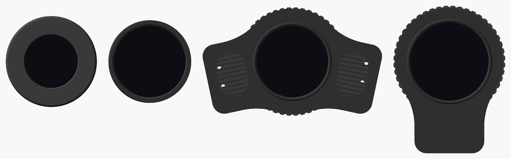
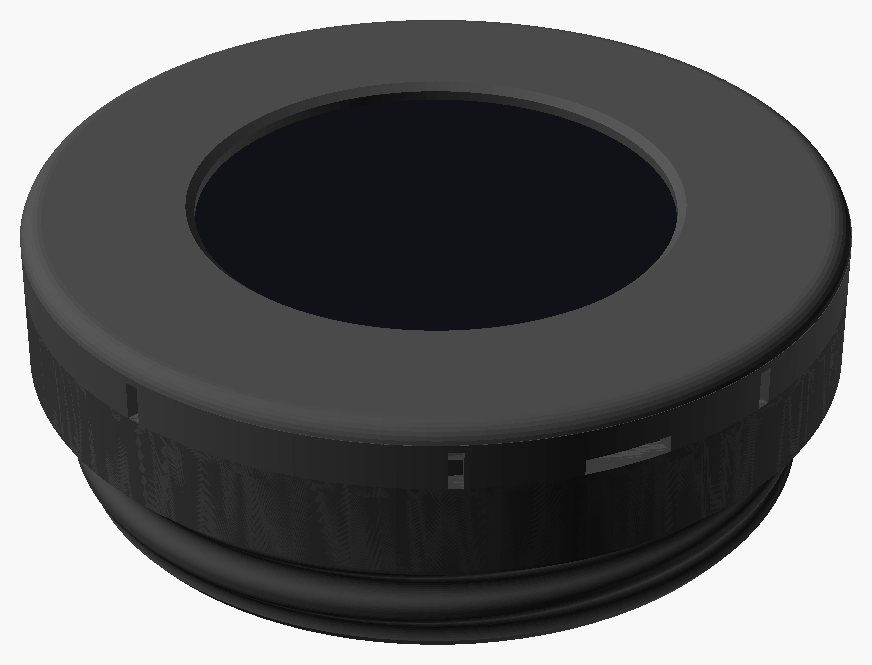
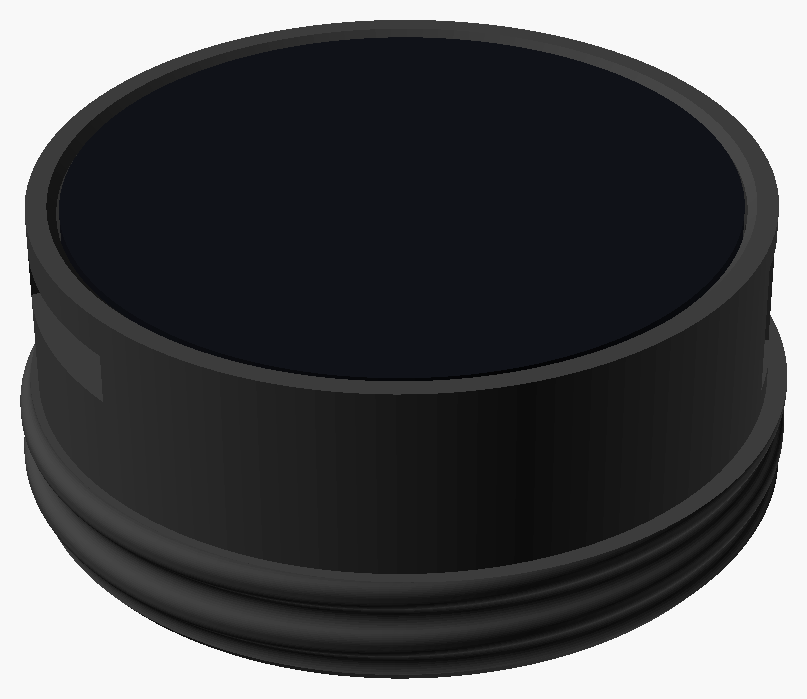
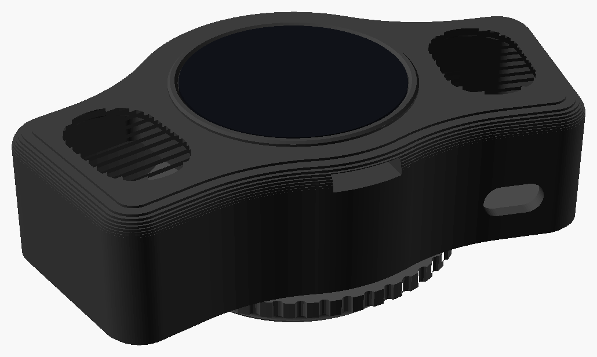
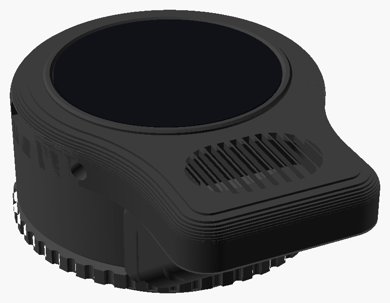

# DroneLab

This project features firmware and 3D printable housings for small round Waveshare touch displays.  While primarily intended to screw into the voice port on the front of an MSA Millennium gas mask, this ecosystem was designed to be flexible.  The immediate audience will be "latex drones" desiring slick high-tech accessories for their gas mask.  Though cosplayers and other costume designers might find the project suits their needs as well.  

What started as a simple application to display images on Waveshare displays has grown into a small platform.  The same firmware runs on several displays, and the bigger ones can also light up with your voice, change it, play sound, control Lovense devices and be run from a phone.

*The housings, to scale.  From left: the 1.28" housing (RP2040 or RP2350), the 1.46" simple housing, the 1.46" speaker housing, and the 1.75" speaker housing.*

## What it does

You swipe up and down between features, and left and right between each feature's pages (see [Using the Display](docs/using-the-display.md)).

- **[Images](docs/features/images.md)**: still images and animated GIFs, built into the firmware or from an SD card.
- **[KITT and the Voice Ring](docs/features/kitt-and-voice-ring.md)**: red bars like KITT's voice box, or a glowing ring around the edge, that light up as you talk.
- **[Voice Effects](docs/features/voice-effects.md)**: changes your voice on the board itself, from a natural female voice to a robot or a Dalek.
- **[Voice Lab](docs/features/voice-lab.md)**: streams the microphone to a computer, for trying out voice effects.
- **[Sound](docs/features/sound.md)**: plays WAV, MP3 and FLAC files from the SD card.
- **[Lovense](docs/features/lovense.md)**: controls up to three Lovense devices over Bluetooth, with patterns and reactions to your voice and movement.
- **[Level](docs/features/level.md)**: a spirit level, for lining the display up on the mask.
- **[Terminal](docs/features/terminal.md)**: shows text typed on a phone, like an old green-screen terminal.
- **[Phone Remote](docs/features/phone-remote.md)**: runs the whole display from a phone's web browser, over the display's own WiFi hotspot, with no app.
- **[Settings](docs/features/settings.md)**: brightness, rotation, what's shown at startup, and the battery voltage.

## Hardware

Four displays are supported, all made by Waveshare.  Each has a 3D printable housing in this repository that screws into the mask's voice port, and a build guide with everything needed to make it.

| | [RP2040-Touch-LCD-1.28](docs/hardware/waveshare_touch_lcd_1_28.md) | [RP2350-Touch-LCD-1.28](docs/hardware/waveshare_touch_lcd_1_28.md) | [ESP32-S3-Touch-LCD-1.46](docs/hardware/waveshare_esp32s3_touch_lcd_1_46.md) | [ESP32-S3-Touch-AMOLED-1.75](docs/hardware/waveshare_esp32s3_touch_amoled_1_75.md) |
|---|---|---|---|---|
| Screen | 1.28" round LCD, 240x240 | 1.28" round LCD, 240x240 | 1.46" round LCD, 412x412 | 1.75" round AMOLED, 466x466 |
| Processor | RP2040, 2 cores, 133 MHz | RP2350, 2 cores, 150 MHz | ESP32-S3, 2 cores, 240 MHz | ESP32-S3, 2 cores, 240 MHz |
| RAM | 264 kB | 520 kB | 512 kB + 8 MB PSRAM | 512 kB + 8 MB PSRAM |
| Microphone | | | One | Two |
| Speaker | | | Built in | Amplifier and speaker socket |
| Micro SD card | | | Yes | Yes |
| WiFi and Bluetooth LE | | | Yes | Yes |
| Accelerometer | Yes (not supported yet) | Yes (not supported yet) | Yes | Yes |
| Battery charging | 1 A | 1 A | Up to 2 A, power button | 300 mA, power button |
| Status | Works | Works | Works | Firmware and housing new, not yet tried |

Which features each one runs:

| Feature | RP2040 1.28" | RP2350 1.28" | ESP32-S3 1.46" | ESP32-S3 1.75" |
|---|:-:|:-:|:-:|:-:|
| [Images](docs/features/images.md) | Yes | Yes | Yes | Yes |
| [Full screen animated GIFs](docs/features/images.md#animated-gif-memory-use) | | Yes | From the SD card | From the SD card |
| [Images from the SD card](docs/features/images.md#images-on-the-sd-card) | | | Yes | Yes |
| [KITT and the Voice Ring](docs/features/kitt-and-voice-ring.md) | | | Yes | Yes |
| [Voice Effects](docs/features/voice-effects.md) | | | Yes | Yes |
| [Voice Lab](docs/features/voice-lab.md) | | | Yes | Yes |
| [Sound](docs/features/sound.md) | | | Yes | Yes |
| [Lovense](docs/features/lovense.md) | | | Yes | Yes |
| [Level](docs/features/level.md) | | | Yes | Yes |
| [Terminal](docs/features/terminal.md) | | | Yes | Yes |
| [Phone Remote](docs/features/phone-remote.md) | | | Yes | Yes |
| [Settings](docs/features/settings.md) | Yes | Yes | Yes | Yes |

### Choosing one

| | |
|---|---|
|  | **[RP2040 or RP2350, 1.28"](docs/hardware/waveshare_touch_lcd_1_28.md)**: the simplest, smallest and cheapest build, for showing images.  Two printed parts and no screws, with the battery and a power switch inside, standing about 12 mm out of the mask.  Get the RP2350: it costs the same as the RP2040 and has room for full screen animated GIFs. |
|  | **[ESP32-S3, 1.46", simple housing](docs/hardware/waveshare_esp32s3_touch_lcd_1_46.md#the-simple-housing)**: every feature, in one printed part with no soldering.  The board's built-in speaker faces into the mask, so it's best for images, voice displays, Lovense control and the phone remote, rather than for sound. |
|  | **[ESP32-S3, 1.46", speaker housing](docs/hardware/waveshare_esp32s3_touch_lcd_1_46.md#the-speaker-housing)**: every feature, with two speakers facing out for sound and voice effects, a 2000 mAh battery and its own USB-C charging port.  The most involved build: two amplifier boards and a small adapter PCB to solder. |
|  | **[ESP32-S3, 1.75" AMOLED](docs/hardware/waveshare_esp32s3_touch_amoled_1_75.md)**: every feature on the biggest, sharpest screen, with true blacks, two microphones, a speaker below the display and a 2000 mAh battery.  The board has its own amplifier, so there's nothing to solder but the speaker's plug.  New: not yet tried on a real board. |

The housings' designs are in [`hardware/`](hardware/), in [OpenSCAD](https://openscad.org/), organized by board.

## How the software is put together

The application in `core/` is the same on every board.  It's written in C with the [LVGL](https://lvgl.io) graphics library, and reaches the hardware only through a small set of functions in [`core/include/hal.h`](core/include/hal.h), which each board implements with its own SDK: [pico-sdk](https://github.com/raspberrypi/pico-sdk) for the RP2040 and RP2350, and [ESP-IDF](https://docs.espressif.com/projects/esp-idf/en/v5.5.5/esp32s3/get-started/) for the ESP32-S3.

- **Features are modules.**  Each one is a single file, and can be switched on or off for a build.  A feature that needs hardware the board doesn't have, like a microphone or WiFi, hides itself.
- **Boards share what they can.**  Adding a display means adding its board folder, with its HAL and screen size, without copying the application around.  The ESP32 boards share everything that doesn't depend on the board.
- **One set of images for every screen.**  Images are converted for each board's screen size when the firmware is built, and the layout scales from 240x240, so the same files and pages work everywhere.

See [Developing](docs/development/README.md) for how it fits together, and how to add a feature or a board.

## Documentation

- **Building one:** pick a display above, then follow its build guide: [1.28"](docs/hardware/waveshare_touch_lcd_1_28.md), [1.46"](docs/hardware/waveshare_esp32s3_touch_lcd_1_46.md) or [1.75"](docs/hardware/waveshare_esp32s3_touch_amoled_1_75.md).  Each has the parts to buy, printing, wiring, putting it together, and building and flashing the firmware.
- **[Building the Firmware](docs/building-firmware.md):** getting the code, setting up pico-sdk or ESP-IDF, building, flashing, and choosing which features to build.
- **[Using the Display](docs/using-the-display.md):** finding your way around, and turning it on and off.
- **[Features](docs/features/README.md):** each feature in detail, with what it needs.
- **[Developing](docs/development/README.md):** how it's put together, [adding a feature](docs/development/adding-a-feature.md), [the hardware abstraction layer](docs/development/hardware-abstraction.md) and [adding a board](docs/development/adding-a-board.md).
- **[Hardware designs](hardware/):** the housings, PCBs and cases, and how they're organized.

## Acknowledgement

The first housing for the 1.28" display was the [RP2040-LCD-1.28-MSA](https://www.printables.com/model/538771-rp2040-lcd-128-msa) model by whyrlpool.  Their voice port thread has been reused by every housing in this project.  The housings are under their own Creative Commons licenses, which are described in [`hardware/`](hardware/README.md#licenses).
