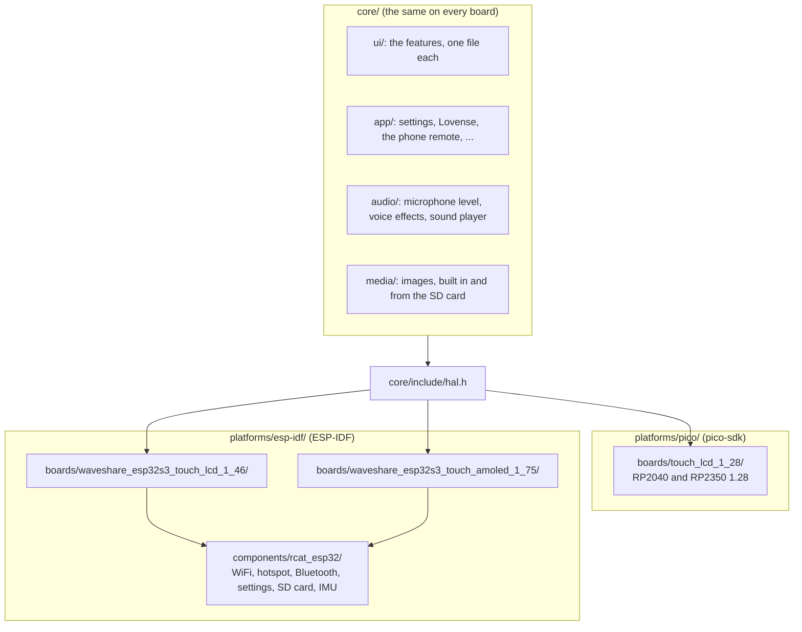

# Developing

This is for working on the firmware itself: how it's put together, and how to add to it.

- [Adding a feature](adding-a-feature.md): a new section of the display, like Images or Level.
- [The hardware abstraction layer](hardware-abstraction.md): how the application reaches the hardware, and how to give it something new.
- [Adding a board](adding-a-board.md): supporting another display, in the firmware and with a housing.

## How it's put together

The application doesn't know which board it's on.  Everything it does is in `core/`, which is plain C and [LVGL](https://lvgl.io), and it reaches the hardware only through a small set of functions in [`core/include/hal.h`](../../core/include/hal.h): the display, touch, backlight, battery, settings storage, microphone, speaker, SD card, WiFi, Bluetooth and accelerometer.  Each board implements those functions for its own hardware, with its SDK.

A few ideas run through it:

- **A board without some hardware just says so.**  A HAL function the board can't do returns `false` (or does nothing), and the feature that needs it hides itself.  So the same application runs on a board with no microphone or WiFi, without any `#if` for the board.
- **Features are modules.**  Each section of the display is one file, `core/ui/feature_<name>.c`, and can be switched on or off for a build in the platform's `features.cmake`.  Switched off, its file isn't compiled at all.
- **Boards share what they can.**  The ESP32 boards share everything that doesn't depend on the board in one component, so a new ESP32 board only needs its own display, touch, audio and power code.
- **Sizes come from the board.**  Everything on screen is laid out for 240x240 and scaled with `ui_px()`, and the images are converted at build time for the board's screen size, so the same layout and the same image files work on every screen.
- **The hardware follows the same pattern.**  The 3D printable housings are organized by board, and what every housing for a mask shares (its thread, the turning collar, the shape of the mask around the port) is in one place (see [`hardware/`](../../hardware/)).

## Project layout

- `core/` - The application itself.  This code doesn't depend on any particular board.
  - `core/include/hal.h` - The functions each board has to provide.
  - `core/ui/` - The features (`feature_<name>.c`), the navigation between them, and shared UI parts.
  - `core/app/` - Settings, the Lovense devices and patterns, the phone remote and its web page, messages for the Terminal.
  - `core/audio/` - The microphone level, voice effects, the Voice Lab stream, and the sound player and its decoders.
  - `core/media/` - The built-in images and the SD card's images.
  - `core/features.cmake` - The list of optional features.  Each platform's `features.cmake` picks which ones to build.
- `platforms/pico/` - Build files for the RP2040 and RP2350 boards.  `boards/*.cmake` lists the supported boards, and `boards/touch_lcd_1_28/` has the HAL and Waveshare's drivers for the 1.28" round display.
- `platforms/esp-idf/` - Build files for the ESP32-S3 boards.  `boards/` has one folder per board, with its HAL, pin assignments, drivers and settings, and `components/rcat_esp32/` has the parts of the HAL that are the same on all of them.
- `hardware/` - The 3D printable housings, PCBs and cases, by board (see [its README](../../hardware/)).
- `third_party/lvgl/` - The [LVGL](https://lvgl.io) graphics library (git submodule).
- `third_party/dr_libs/` - The [dr_libs](https://github.com/mackron/dr_libs) WAV, MP3 and FLAC decoders (git submodule).
- `imgs/` - The built-in images.
- `docs/` - This documentation.
- `tools/` - Scripts, below.

## Tools

- `tools/img2c.py` - Converts an image or GIF into a C file for a screen size.  The build runs it for every image in `imgs/`.
- `tools/prepare_sd.py` - Resizes and re-encodes images for an SD card (see [Images on the SD card](../features/images.md#images-on-the-sd-card)).
- `tools/voice_monitor.py` - Plays and records the microphone stream from the [Voice Lab](../features/voice-lab.md), with voice effects.
- `tools/gen_remote_page.py` - Turns `core/app/remote_page.html`, the [Phone Remote](../features/phone-remote.md)'s page, into the C file that's built in.  Run it after changing the page.
- `tools/gen_terminal_font.py` - Makes the [Terminal](../features/terminal.md)'s font, `core/ui/terminal_font.c`.
- `tools/gen_lv_conf.py` - Generates the platforms' `lv_conf.h` files (LVGL's settings) from LVGL's template.  Run it after updating the LVGL submodule.
- `tools/doc_renders/render.sh` - Renders the pictures of the housings in `docs/images/`.  Run it after changing a housing's design.
- `tools/gen_logo.py` - Draws the DroneLab logo shown at startup, `core/ui/assets/dronelab_logo.png`, and prints where its blinking cursor goes (`SPLASH_CURSOR` in `core/app/app.c`).  It needs two free fonts from Google Fonts, listed at its top.

## Threads

The UI runs on a single loop, which just runs LVGL's timers (see `app_run()` in [`core/app/app.c`](../../core/app/app.c)).  Anything a feature does regularly, like updating KITT's bars or polling the Lovense devices, is an LVGL timer (`lv_timer_create()`), so it runs on that loop and can use LVGL freely.  The microphone and speaker callbacks run on the board's audio tasks, and Bluetooth on its own task, so they mustn't call LVGL.  They leave their results where the UI's timers pick them up.

## Checking a change

Build every platform the change touches, as described in [Building the Firmware](../building-firmware.md).  A change to `core/` or `hal.h` touches all of them: the RP2040, the RP2350 and both ESP32-S3 boards.  Every build should finish without warnings.  It's also worth building once with the new feature switched off.
