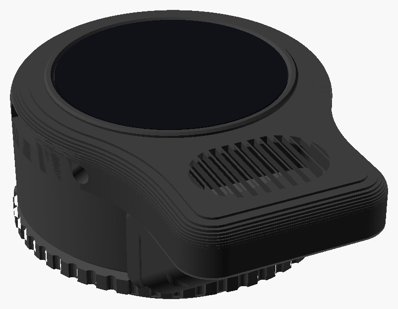
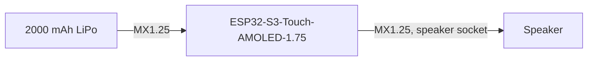

# Building with the ESP32-S3-Touch-AMOLED-1.75

The [Waveshare ESP32-S3-Touch-AMOLED-1.75](https://docs.waveshare.com/ESP32-S3-Touch-AMOLED-1.75) is a 1.75" round AMOLED touch screen (466x466) on an ESP32-S3 with 8 MB of PSRAM.  It has everything the 1.46" board has, plus two microphones, a speaker amplifier with its own socket, and a power management chip that charges the battery gently.  Every [feature](../features/README.md) runs on it.  Get the bare board, not the -B version that comes in its own case.

**Status: new.**  The firmware supports it, and the housing is designed, but neither has been tried on a real board or printed yet, so expect a few things to need adjusting.



The housing screws into the voice port of an MSA Millennium mask, with a speaker in a shallow pod below the display that faces out, and a 2000 mAh battery in a chamber behind.  Below the voice port is the mask's filter mount, so the pod stays in front of it, and a sloped chin behind the pod clears it (by about 4.7 mm, measured from a 3D scan of a mask).  A turning collar holds the housing level while it's screwed in.

The board's own amplifier, speaker socket and microphones are used, so there are no other boards to wire in: the speaker and the battery plug straight into the board.

## Board notes

- **Power:** the board runs from USB-C or from a 3.7 V LiPo battery on its MX1.25 connector (check the polarity before plugging a battery in), and charges the battery at 300 mA, which is safe for any battery that fits.  Press `PWR` to turn it on, and hold it for 2 seconds to turn it off.
- **Brightness:** an AMOLED has no backlight, so the Brightness setting dims the screen itself.  Black parts of the picture are truly off.
- **Microphones:** the two microphones are mixed together.  Their gain is `MIC_GAIN_DB` in the board's `hal_board.c`.
- **Speaker:** the microphones and the speaker share one audio clock, so sound is resampled to 32 kHz for the speaker, which is plenty for a small speaker.  `SPK_VOLUME` in `hal_board.c` sets how loud the board's amplifier goes, on top of the volume setting.
- **Level:** the accelerometer's directions are taken from the 1.46" board and haven't been checked on this one.  If the [Level](../features/level.md) reads the wrong way, see `rcat_hal_accel_read()` in `hal_board.c`.
- **Not used yet:** the clock chip, and the GPS on the -G version.

## Parts to buy

- A [Waveshare ESP32-S3-Touch-AMOLED-1.75](https://docs.waveshare.com/ESP32-S3-Touch-AMOLED-1.75), the bare board
- A speaker module, 35 x 25 x 6.5 mm sealed box with an oval cone on the front, 4 ohm, with an MX1.25 2-pin plug (or one crimped on)
- A LiPo battery up to 50.5 x 34 x 9.9 mm (a 103450, 2000 mAh) with an MX1.25 2-pin plug.  Check its polarity against the board before plugging it in.
- M2 socket head screws: four M2 x 8 for the back, four M2 x 6 for the washer, and four M2 x 8 for the chin
- Three M2 x 5 countersunk screws for the board

## Printing

The design is [`hardware/boards/waveshare_esp32s3_touch_amoled_1_75/msa_speaker_housing.scad`](../../hardware/boards/waveshare_esp32s3_touch_amoled_1_75/), in [OpenSCAD](https://openscad.org/).  Run `./render.sh` in that folder to make the STL files.  Its README lists the parts, how to print them, and the test prints to check first: the glass's fit (`lens_fit`), the micro SD slot, and the speaker (`pod_test`).

## Wiring



The speaker and battery sockets stand up off the back of the board, so their plugs go in from behind, through openings in the housing's back plate.

## Putting it together

1. Push the plungers in from inside the display's pocket, then fit the board and screw it to the back plate with the countersunk screws.
2. Stick the speaker into its pocket from the back of the pod, then screw the chin on.  Leave the speaker's wire out through the opening at the inner end of the pocket, into the chamber.
3. Plug the speaker into the board's speaker socket, through the opening in the back plate.
4. Plug in the battery the same way, and tape it to the back.
5. Screw the back on with the M2 x 8 screws.
6. Put the gasket over the posts, then the collar, grip first.
7. Drop each half of the washer in through the threaded end, line its holes up with two posts, and screw it down with the M2 x 6 screws.  Stop when the collar turns firmly but smoothly.

The USB-C port is reachable through a pocket in the right-hand side, for charging and flashing, with a small plug to cover it when it's not in use.

## Building the firmware

Set up ESP-IDF as described in [Building the Firmware](../building-firmware.md#esp32-s3-boards), then from the top of the repo:

```
idf.py -C platforms/esp-idf -B build-s3-175 -DBOARD=waveshare_esp32s3_touch_amoled_1_75 build
idf.py -C platforms/esp-idf -B build-s3-175 -p /dev/ttyACM0 flash monitor
```

## After it's built

- In the housing, the board is turned a quarter turn so its USB-C port faces the side, so set [Rotation](../features/settings.md#rotation) to 90 degrees.
- Put images, sounds and Lovense patterns on a micro SD card (see [Images](../features/images.md#images-on-the-sd-card), [Sound](../features/sound.md#sounds-on-the-sd-card) and [Lovense](../features/lovense.md#patterns-on-the-sd-card)).  Images for this board are 466 pixels across.
- On the first run, check that the picture isn't shifted and that touches land where you tap, and send the board's log (from `monitor`) if anything's off.
