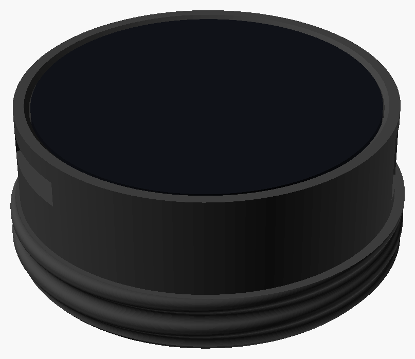
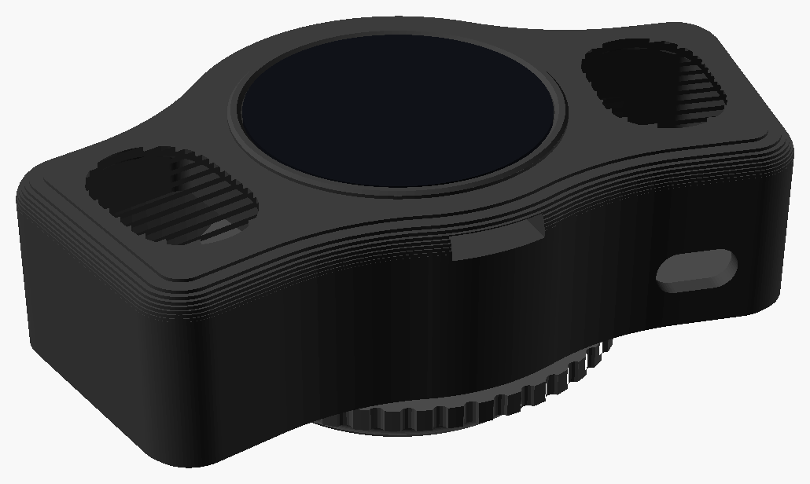
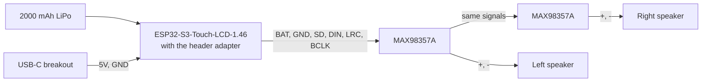

# Building with the ESP32-S3-Touch-LCD-1.46

The [Waveshare ESP32-S3-Touch-LCD-1.46](https://docs.waveshare.com/ESP32-S3-Touch-LCD-1.46) is a 1.46" round touch screen (412x412) on an ESP32-S3 with 8 MB of PSRAM, a microphone, a built-in speaker, a micro SD card slot, WiFi, Bluetooth, an accelerometer and a battery charger.  Every [feature](../features/README.md) runs on it.  Get the version **with the cover glass**: the housings are made for it.

There are two housings for it, both screwing into the voice port of an MSA Millennium mask:

| The simple housing | The speaker housing |
|---|---|
|  |  |
| One printed part.  The board in front, a small battery inside the thread.  Uses the board's built-in speaker, which faces into the mask. | The display between two speakers that face out, with their own amplifiers, a 2000 mAh battery and a USB-C charging port in a chamber behind.  A turning collar holds it level. |
| No soldering.  The board, thread, micro SD slot and buttons have been checked with full prints. | More parts to buy, and some soldering, including a small adapter PCB.  It's been fully assembled and worn. |

## Board notes

- **Power:** the board runs from USB-C or from a 3.7 V LiPo battery on its 2-pin MX1.25 connector (check the polarity before plugging a battery in).  On battery, press the `PWR` button on the side to turn it on.  The firmware keeps the power switched on after you let go.  Hold `PWR` for 2 seconds to turn it off.
- **Charging:** the board charges its battery at up to 2 A, set by R8 (82k), which is more than either housing's battery should take.  The simple housing covers the USB-C port so it can't be plugged in by accident.  It's worth changing R8: to about 390k (about 0.4 A) for the simple housing's 702030 battery, or about 180k (about 0.9 A) for the speaker housing's 2000 mAh battery.  The charge current is roughly 165 kΩ·A divided by R8.  R8 is a tiny 0201 part, so it's fine soldering work; measure the current with a USB meter afterwards.
- **Rotation:** the display controller can't rotate the picture by 90 degrees itself, so the ESP32 rotates it while drawing.  It's fast enough that you shouldn't notice.
- **Not used yet:** the clock chip.

## The simple housing

The board sits in a cup on the outside of the mask, with its glass flush with the front.  Its micro SD slot and side buttons stay reachable, and the buttons are pressed through flexible tabs in the wall.  The cup's back plate carries the voice port thread, and the space inside the thread holds the battery.

### Parts to buy

- A [Waveshare ESP32-S3-Touch-LCD-1.46](https://docs.waveshare.com/ESP32-S3-Touch-LCD-1.46), the version with the cover glass
- A 702030 LiPo battery (7 x 20 x 30 mm) with a JST 1.25 mm plug
- A short JST 1.25 mm 2-pin extension cable, for the battery
- Three M2 countersunk screws, about M2 x 5

### Printing

In [`hardware/boards/waveshare_esp32s3_touch_lcd_1_46`](../../hardware/boards/waveshare_esp32s3_touch_lcd_1_46/), run `./render.sh simple` (it needs [OpenSCAD](https://openscad.org/)) and print `stl/housing.stl`, front down.  That folder's README has more about the design, and some optional test prints.

### Putting it together

1. Plug the extension cable into the board's battery socket.  It's between the board and the back plate, so it can't be reached once the board is in.
2. Fit the board into the cup from the front, with the extension's wires out through the opening in the back plate.
3. Screw the board to the back plate with the three M2 screws, from the back, through the inside of the thread, into the standoffs on the board.
4. Plug the battery into the extension and tuck it into the space inside the thread.

To use USB (to flash new firmware, or to charge), take the board out and unplug the battery first.  To print the housing with an opening for the port, set `usb_access = true` in the design.

## The speaker housing

The display sits in the middle, with a small speaker in a pod on each side, and a chamber behind for the battery, two MAX98357A amplifier boards and a USB-C charging port.  The voice port thread is on a collar that turns on the back, so the housing can be held level while the collar is screwed in.  The board is turned a quarter turn, with its buttons at the top, so set [Rotation](../features/settings.md#rotation) to match.

### Parts to buy

- A [Waveshare ESP32-S3-Touch-LCD-1.46](https://docs.waveshare.com/ESP32-S3-Touch-LCD-1.46), the version with the cover glass
- Two speaker modules, 35 x 25 x 6.5 mm sealed boxes with an oval cone on the front (DWEII 3525, 4 ohm 3 W)
- A LiPo battery up to 50.5 x 34 x 9.9 mm (a 103450, 2000 mAh), rated to charge at 1C, with a JST 1.25 mm plug
- Two MAX98357A amplifier boards
- A USB-C breakout with 5.1k resistors from CC1 and CC2 to GND
- The J9 header adapter PCB (see below), with its parts, and a 10-pin JST SH cable (A10SR10SR30K102A, 4") cut near one end
- Two 220 uF 10 V low-ESR electrolytic capacitors, 6.3 mm diameter
- M2 socket head screws: four M2 x 8 for the back, four M2 x 6 for the washer, and six M2 x 10 with nuts and washers for the boards
- Three M2 countersunk screws, about M2 x 5, for the board

### The header adapter PCB

A small PCB that solders onto the 2x10, 1.27 mm pin header (J9) on the back of the board.  All the wiring to the back of the housing plugs into one 10-pin JST SH socket on it, so the board can come out for a firmware update without cutting anything.

- **Gerbers:** [`header_adapter_gerbers.zip`](../../hardware/boards/waveshare_esp32s3_touch_lcd_1_46/header_adapter/fab/header_adapter_gerbers.zip), ready to upload to a board house.  Order it 2 layers, 1.6 mm thick, 1 oz copper, in any finish and color.  It's about 11 x 16 mm.
- **Parts:** a JST SM10B-SRSS-TB socket, a 10k 0603 resistor, and a JST SHR-10V-S housing with SH crimp leads for the mating plug.
- **Fitting it:** see the [adapter's README](../../hardware/boards/waveshare_esp32s3_touch_lcd_1_46/header_adapter/), which has the pinout, the orientation and the checks to do before powering it up.  It hasn't been fitted to a board yet.

### Printing

In [`hardware/boards/waveshare_esp32s3_touch_lcd_1_46`](../../hardware/boards/waveshare_esp32s3_touch_lcd_1_46/), run `./render.sh speaker` (it needs [OpenSCAD](https://openscad.org/)) to make the STL files in `stl/`.  That folder's README says how to print each part, and lists every screw and where it goes.

### Wiring

Everything but the battery connects through the socket on the header adapter.  The battery plugs into the board's own battery socket.



| SH pin | Signal | Header pin | Goes to |
|---|---|---|---|
| 1 | GND | 3, 4, 12 | USB-C breakout GND |
| 2 | BAT | 2 | Vin on both amplifiers |
| 3, 4 | USB_5V | 1 | USB-C breakout VBUS |
| 5 | GND | 3, 4, 12 | USB-C breakout GND |
| 6 | GND | 3, 4, 12 | GND on both amplifiers |
| 7 | SD (GPIO1) | 11 | SD on both amplifiers.  The 10k resistor to GND is on the adapter. |
| 8 | DIN (GPIO3) | 13 | DIN on both amplifiers |
| 9 | LRC (GPIO13) | 20 | LRC on both amplifiers |
| 10 | BCLK (GPIO12) | 18 | BCLK on both amplifiers |

- Wire each amplifier signal to the first amplifier, then run a short wire from there to the same pad on the second one, so nothing needs splicing.
- Each speaker connects to its amplifier's + and - outputs, neither of which is ground.  Leave GAIN unconnected.
- BAT is connected straight to the battery, so the 10k resistor keeps the amplifiers switched off while the board is off.
- Put a 220 uF capacitor across Vin and GND at each amplifier, stripe to GND.  Lay it on its side, as standing up it nearly touches the back of the speaker.
- Don't plug into the board's own USB-C port and the housing's at the same time.

### Putting it together

1. Solder the header adapter onto the board's 2x10 header (see its README).  Push the plungers in from inside the display's pocket, then fit the board and screw it in with the three countersunk screws.
2. Stick each speaker into its pocket from the back.  The adhesive frame on its front holds it to the grille.
3. Screw the amplifiers and the USB-C breakout to the back: each M2 x 10 goes through the back from outside, then a spacer, the board and a nut.  Tape the battery to the back with its leads at the upper left, seen from the front (upper right from the back), next to the board's battery socket.
4. Wire it up, then screw the back on with the M2 x 8 screws.
5. Put the gasket over the posts, then the collar, grip first.
6. Drop each half of the washer in through the threaded end, line its holes up with two posts, and screw it down with the M2 x 6 screws.  Stop when the collar turns firmly but smoothly.

To take the board out for a firmware update, take the back off, unplug the SH cable and then the battery, then take out the board's three screws and push it out the front.  The adapter comes with it.

## Travel case

There's a hinged case to carry the simple housing in, in [`hardware/boards/waveshare_esp32s3_touch_lcd_1_46/travel_case`](../../hardware/boards/waveshare_esp32s3_touch_lcd_1_46/travel_case/).  It prints in one go, all five parts laid out together.

## Building the firmware

Set up ESP-IDF as described in [Building the Firmware](../building-firmware.md#esp32-s3-boards), then from the top of the repo:

```
idf.py -C platforms/esp-idf -B build-s3-146 -DBOARD=waveshare_esp32s3_touch_lcd_1_46 build
idf.py -C platforms/esp-idf -B build-s3-146 -p /dev/ttyACM0 flash monitor
```

Pick where the sound goes first, with `RCAT_SPEAKER` in `platforms/esp-idf/features.cmake`:

- `EXTERNAL` (the default) for the speaker housing's amplifiers.  The firmware switches them on with SD only while sound is playing.
- `BUILT_IN` for the board's own speaker, in the simple housing.  The small round trimmer on the back of the board sets its volume, on top of the volume setting.

## After it's built

- Put images, sounds and Lovense patterns on a micro SD card (see [Images](../features/images.md#images-on-the-sd-card), [Sound](../features/sound.md#sounds-on-the-sd-card) and [Lovense](../features/lovense.md#patterns-on-the-sd-card)).
- In the speaker housing, set [Rotation](../features/settings.md#rotation) to match the board.
- Use the [Level](../features/level.md) to check the display sits straight.
