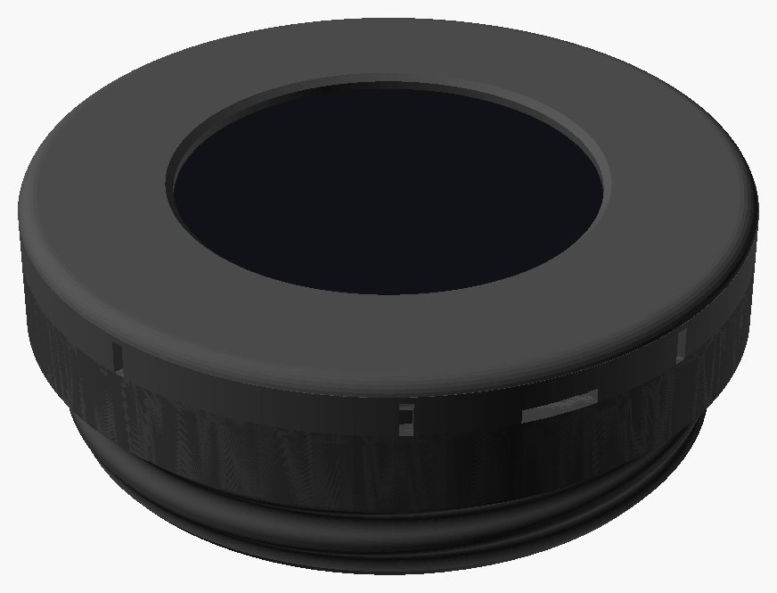
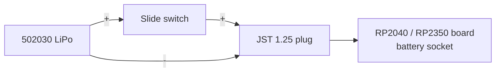

# Building with the RP2040-Touch-LCD-1.28 or RP2350-Touch-LCD-1.28

The [Waveshare RP2040-Touch-LCD-1.28](https://www.waveshare.com/wiki/RP2040-Touch-LCD-1.28) and [RP2350-Touch-LCD-1.28](https://www.waveshare.com/wiki/RP2350-Touch-LCD-1.28) are the same shape: a 1.28" round touch screen (240x240) with a battery charger and an accelerometer.  They show [images](../features/images.md) and [settings](../features/settings.md); they have no microphone, speaker, SD card slot, WiFi or Bluetooth.  They're the simplest and cheapest build, and the smallest on the mask.

**Which one?**  They cost about the same, and the RP2350 has twice the RAM (520 kB against 264 kB), so it can play full screen animated GIFs, which the RP2040 can't (see [Animated GIF memory use](../features/images.md#animated-gif-memory-use)).  Get the RP2350.



The housing is two printed parts and no screws.  The body has the voice port thread on its back, and holds the board, the battery in a cradle inside the thread, and a slide switch in its side wall.  The bezel snaps over the front and holds the board in by its glass.  Nothing sticks out of the back, so it screws all the way in and sits flat.  It stands about 12 mm out of the mask.

**Status: new.**  The housing is designed but hasn't been printed yet.  It replaces the [RP2040-LCD-1.28-MSA](https://www.printables.com/model/538771-rp2040-lcd-128-msa) model by whyrlpool, which this project started out with, and whose voice port thread it uses.

## Parts to buy

- A [Waveshare RP2350-Touch-LCD-1.28](https://www.amazon.com/dp/B0DLBF5QKK) *or* [RP2040-Touch-LCD-1.28](https://www.amazon.com/dp/B0C4LRRVVN)
- A [3.7 V 250-310 mAh 502030 LiPo battery](https://www.amazon.com/dp/B08TBY5BFL) (5 x 20 x 30 mm) with a JST 1.25 mm plug.  **The battery at that link has its plug wired the opposite way from what the board wants.  Swap the + and - wires in the plug, or solder on a new one, before you plug it in.**
- [JST 1.25 mm 2-pin cables](https://www.amazon.com/dp/B013JRWCBU), to wire the switch in
- An SS12D00-style slide switch (8.6 x 3.6 mm, with its lever on top)
- 1 mm foam tape, for the top of the battery

## Printing

The design is [`hardware/boards/waveshare_touch_lcd_1_28/msa_housing.scad`](../../hardware/boards/waveshare_touch_lcd_1_28/), in [OpenSCAD](https://openscad.org/).  Set `board` to `"rp2040"` or `"rp2350"` in `board.scad`, then run `./render.sh` in that folder to make the STL files.  Its README lists the parts and how to print them.

1. Print `fit_test`, the front of the body without the thread, to check the board, the switch and the bezel fit.
2. Print `phase_test`, the thread with a scale on its front, screw it all the way into the mask, hold the mask upright and read the number at the top.  Set `thread_phase` to it, so the housing ends up level.
3. Print the `body` and the `bezel`.  PETG is a good choice for both, as the bezel's skirt and the switch's catch flex.

## Wiring

The switch goes in the battery's + lead, between the battery and the plug for the board:



Check the polarity at the plug against the board before plugging it in.

## Putting it together

1. Wire the switch into the battery's + lead.
2. Push the switch into its pocket from inside the body, lever first, until it clicks past the catch and its lever is out through the slot.
3. Stick the foam tape over the top of the battery, and lay it in its cradle with its leads at the left, in the notch.
4. Plug the battery into the board, then drop the board in, with its USB-C port at the right-hand side of the pocket and the plug in the space beside the board.
5. Snap the bezel on.  To take it off again, pry it up with a fingernail at the notch at the bottom.

## Charging

The USB-C port is reachable through a pocket in the right-hand side of the housing.  The boards charge their battery at 1 A, which is more than a 250-310 mAh LiPo is meant to take, so don't leave it charging unattended.  The firmware can't change this.

To charge more gently, change R15 on the board.  Its charger (an ETA6096) sets the charge current from R15, at roughly 165 kΩ·A divided by its resistance:

| R15 | Charge current |
|---|---|
| 160k (as fitted) | 1 A |
| 390k | about 0.4 A |
| 560k | about 0.3 A |

Below about 300 mA isn't sensible, as the charger always starts a flat battery at 200 mA, and stops at 130 mA.  The datasheet only covers 1.2 to 2 A, so measure the current with a USB meter after the change.  Or unplug the battery and charge it with a separate small LiPo charger.

## Travel case

There's a hinged case to carry the housing in, in [`hardware/boards/waveshare_touch_lcd_1_28/travel_case`](../../hardware/boards/waveshare_touch_lcd_1_28/travel_case/).  It prints in one go, all five parts laid out together.

## Building and flashing the firmware

Set up pico-sdk as described in [Building the Firmware](../building-firmware.md#rp2040-and-rp2350-boards), then from the top of the repo, for the RP2350 board:

```
cmake -S platforms/pico -B build-rp2350 -DBOARD=waveshare_rp2350_touch_lcd_1_28
cmake --build build-rp2350 -j
```

For the RP2040 board, use `build-rp2040` and `waveshare_rp2040_touch_lcd_1_28`.

To flash it with the board in the housing, plug in the USB-C cable and run `picotool load -f -x build-rp2350/dronelab.uf2`.  The `-f` restarts the board into its programming mode by itself, so you don't have to reach the `BOOT` button.  The first time, before this firmware is on the board, hold `BOOT` while pressing `RESET` and copy the `.uf2` file onto the USB drive that appears.

## After it's built

- In the housing, the board is turned a quarter turn so its USB-C port faces the side, so set [Rotation](../features/settings.md#rotation) to 90 degrees.
- The images are built into the firmware, so changing them means rebuilding it (see [Adding or changing built-in images](../features/images.md#adding-or-changing-built-in-images)).
